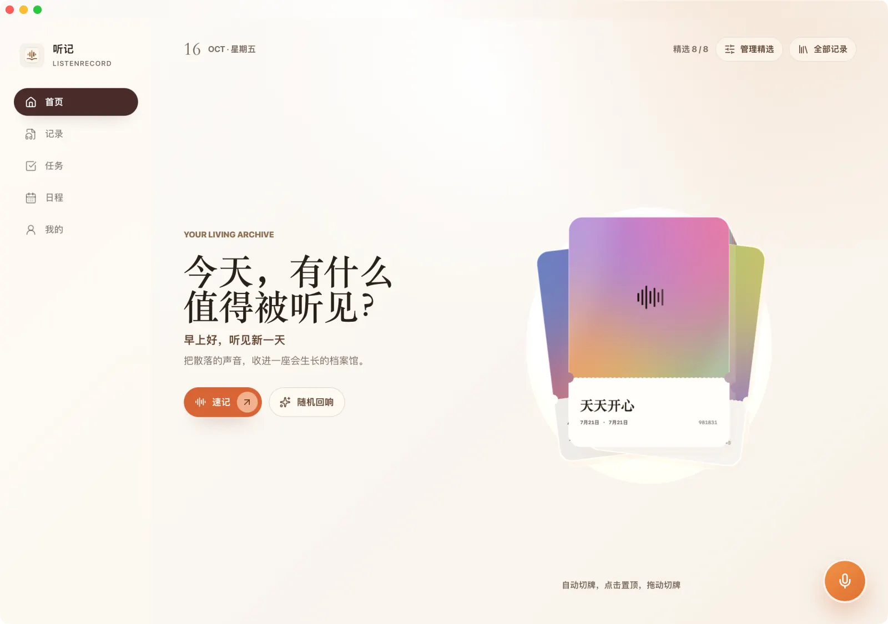
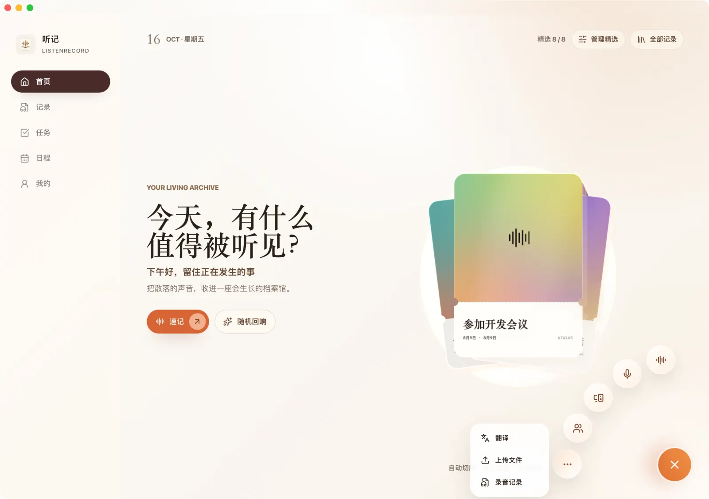
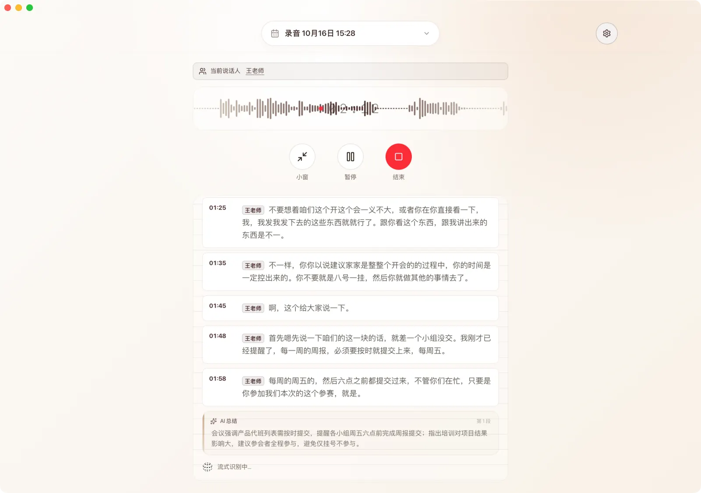
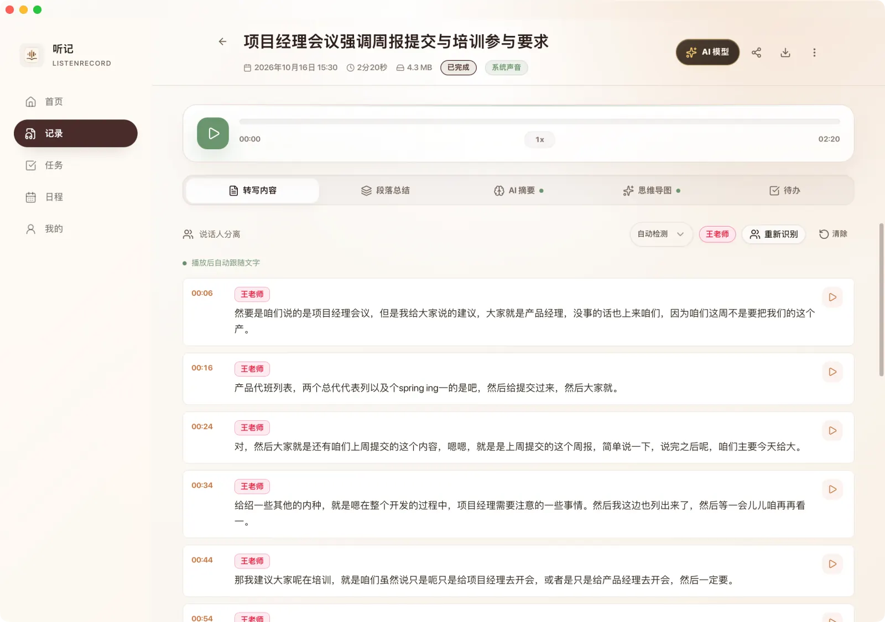
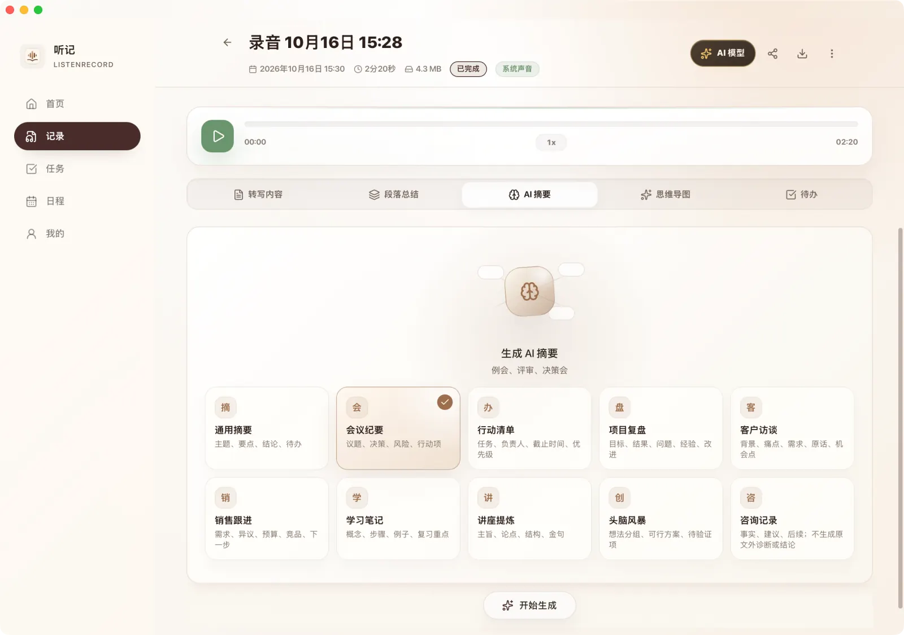
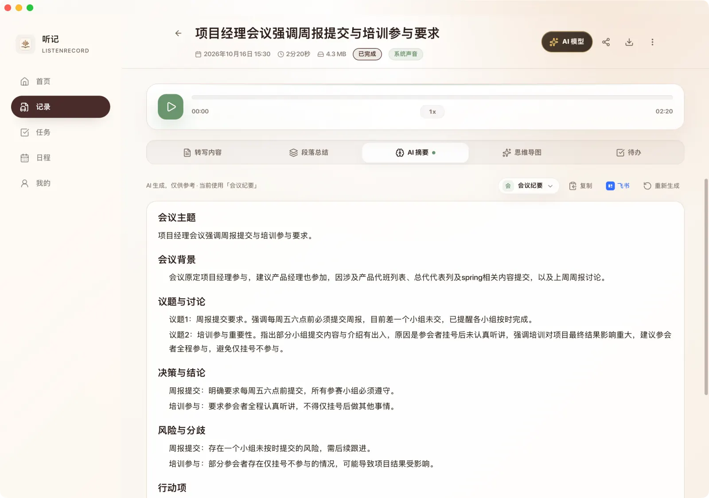
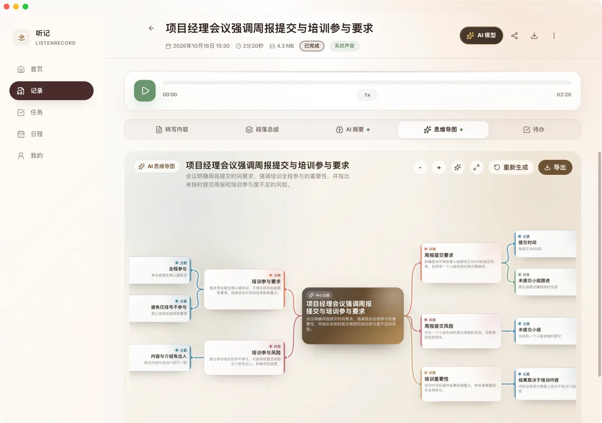
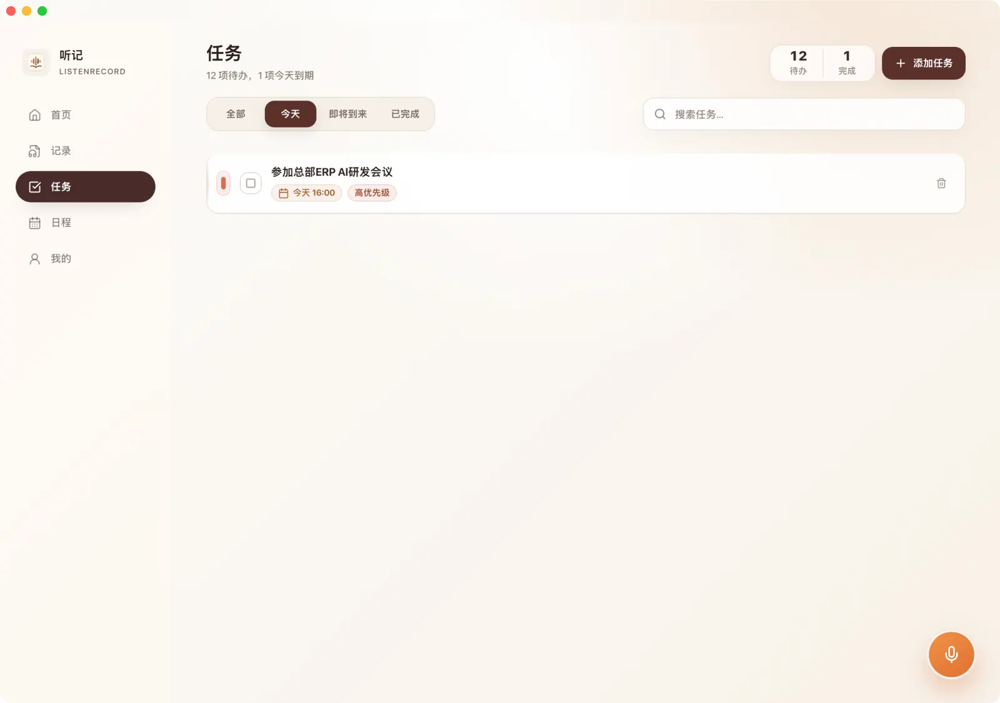
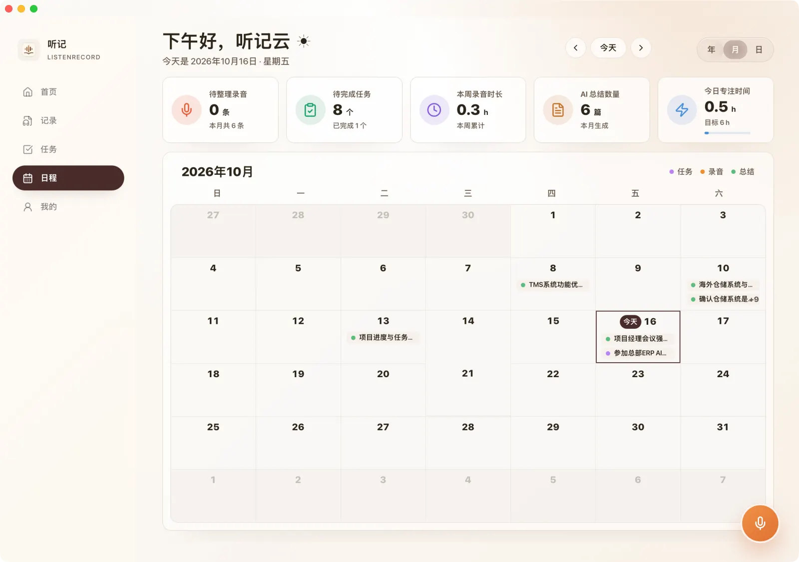

# ListenRecord

**Record, transcribe and summarize — in one app** · Tauri 2 · Vue 3 · Rust

[中文](README.md) | [**English**](README.en.md)

> Record a meeting, an interview or a lecture — and get text, a summary and action items. **Speech recognition runs on your machine; the raw audio never has to be uploaded.**

[**⬇︎ Download the latest version**](https://github.com/Linlx0628/listenrecord-app/releases/latest) · [Website](https://www.lingerx.cn) · [Changelog](CHANGELOG.md) · [Report an issue](https://github.com/Linlx0628/listenrecord-app/issues)

## Highlights

- **On-device speech recognition** — once models are downloaded, recognition runs locally; recordings work without uploading
- **Dual-stream meetings** — microphone and system audio are transcribed separately, so you can tell who said what
- **AI meeting notes** — 10 summary templates covering topics, decisions, risks and action items
- **AI mind map · paragraph summaries · translation**
- **Speaker diarization** — speakers are separated automatically, with timestamps you can jump back to
- **Agent Access** — summaries and tasks, exposed read-only to terminal agents such as Codex and Claude Code
- **Encrypted sync** — meetings and tasks sync across devices with end-to-end encryption; changing the password does not re-encrypt history
- **Every platform** — macOS Apple Silicon / Windows x64 / Linux x86_64 / Android arm64
- **Feishu document and task sync · multi-format export**

## Interface preview

|  |  |
|:--:|:--:|
|  |  |
| **Home** — one entry point for recordings, tasks and calendar | **Recording actions** — quick note, translation, file transcription, recording history |
|  |  |
| **Live transcription** — record and transcribe at once, with waveform and streaming status | **Transcript** — timestamps and speaker separation, jump back to any moment |
|  |  |
| **Summary templates** — 10 built-in templates by meeting type | **AI summary** — topics, decisions, risks and action items |
|  |  |
| **AI mind map** — expand the meeting structure into an exportable map | **Tasks** — action items extracted from meetings, with priority and due time |
|  | More screens and an interaction walkthrough on the website [https://www.lingerx.cn](https://www.lingerx.cn) |
| **Calendar** — monthly view aggregating recordings, tasks and AI summaries | |

## Download

Always get the current public version from [Latest Release](https://github.com/Linlx0628/listenrecord-app/releases/latest) rather than guessing asset URLs from historical naming conventions.

| Platform and architecture | Installer | In-app update | Install notes |
|---------------------------|-----------|---------------|---------------|
| macOS Apple Silicon (aarch64) | [DMG](https://github.com/Linlx0628/listenrecord-app/releases/latest) | Supported | System audio requires screen-recording permission; on first launch macOS may also show a security prompt — verify the download source and follow the system guidance. |
| Windows x64 | [NSIS EXE](https://github.com/Linlx0628/listenrecord-app/releases/latest) | Supported | Run the installer after downloading; if the system shows a security prompt, verify the publisher and download source first. |
| Linux x86_64 / amd64 | [AppImage / DEB](https://github.com/Linlx0628/listenrecord-app/releases/latest) | Supported | The AppImage may need execute permission; system audio capability depends on your local PulseAudio/PipeWire setup. In-app updates use the same AppImage file offered on the website. |
| Android (`arm64-v8a`) | [APK](https://github.com/Linlx0628/listenrecord-app/releases/latest) | Not applicable (no desktop updater) | Sideloading requires allowing installs from unknown sources; only grant this to a trusted download source. |

## More

- **Engineering notes** — why Tauri 2, how streaming ASR works, three system-audio stacks, the envelope design behind encrypted sync, the Android `DT_NEEDED` pitfall, release engineering: [TECHNICAL.en.md](TECHNICAL.en.md)
- **Release history**: [CHANGELOG.md](CHANGELOG.md)
- **Security reports**: [SECURITY.md](SECURITY.md)

## Boundaries

- This is **local-first, not fully offline**: the initial model download, online AI, accounts and entitlements, encrypted sync, Feishu, email and update checks reach the network as needed
- Desktop supports system-audio capture and meeting dual streams; Android and iOS do not, so mobile is not a full replica of desktop capability
- Download only from this repository's [Releases](https://github.com/Linlx0628/listenrecord-app/releases) or the website [www.lingerx.cn](https://www.lingerx.cn)

## Feedback and licensing

- Feedback and partnership: [GitHub Issues](https://github.com/Linlx0628/listenrecord-app/issues) · [listennote@lingerx.cn](mailto:listennote@lingerx.cn)
- This repository is a **binary distribution repository**: it does not contain the application source code and does not amount to licensing the application under any open-source licence
- Specific rights and restrictions are governed by the formal software licence and terms of service
