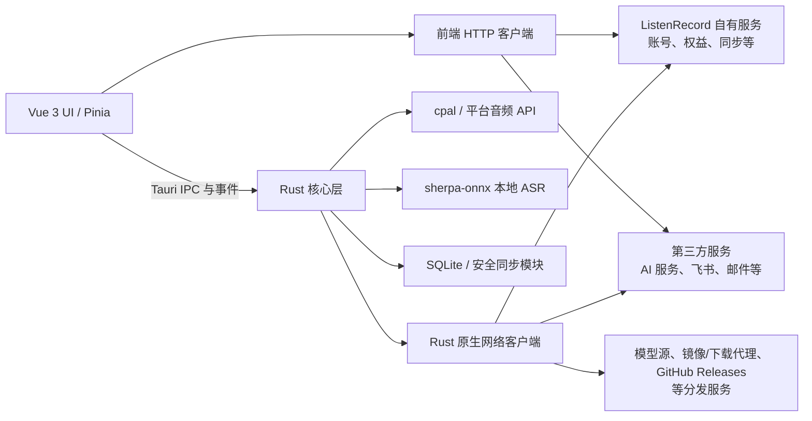
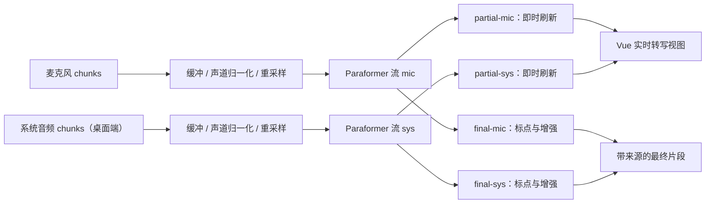

# 听记 ListenRecord

**跨平台本地优先的 AI 录音与会议纪要应用** · Tauri 2 · Vue 3 · Rust

[**中文**](README.md) | [English](README.en.md)

> 本仓库是**二进制分发仓库**：用于发布听记的安装包、桌面自动更新元数据和版本说明，**不包含应用源代码**。

- 官网：[https://www.lingerx.cn](https://www.lingerx.cn)
- 最新版本：[Latest Release](https://github.com/Linlx0628/listenrecord-app/releases/latest)
- 历史版本：[All Releases](https://github.com/Linlx0628/listenrecord-app/releases) · [CHANGELOG.md](CHANGELOG.md)
- 问题反馈：[Issues](https://github.com/Linlx0628/listenrecord-app/issues) · 安全漏洞请见 [SECURITY.md](SECURITY.md)

## 产品是什么

听记是一款面向会议、访谈、课程和个人记录的跨平台录音应用。它把录音、实时转写和后续知识整理放在同一个工作流中：录制麦克风或桌面系统音频，实时生成文字，再基于转写内容生成 AI 摘要、标题和待办；同时提供翻译、思维导图、飞书文档与任务同步、数据备份，以及会议/任务记录的加密同步能力。

近期版本继续沿着“记录更顺手、整理更省事”的方向推进：移动端底部录音按钮支持上拉直接进入速记、长按 3 秒开始麦克风录音；首页牌组会自动提取最近的录音与未完成任务，并支持按住展开选牌；托盘日程面板补上中国节假日与调休补班标注；**「Agent 接入」可以把会议摘要与任务以只读方式提供给 Codex、Claude Code 等终端 Agent 使用**。

  
  
  

“本地 AI”在这里有明确边界：**录音处理，以及模型下载完成后的 ASR 推理在本机运行**。首次获取语音模型仍需联网；AI 摘要、标题、待办提取、翻译等智能服务，以及账号与权益、加密同步、飞书、邮件和版本更新，也会按照所使用的功能访问网络。听记不是一款可以被笼统描述为“完全离线”的应用。

## 界面预览

|  |  |
|:--:|:--:|
|  |  |
| **首页** —— 录音、任务与日程的统一入口 | **录音入口** —— 速记、翻译、文件转写与录音记录 |
|  |  |
| **实时转写** —— 边录边转，波形与流式识别状态实时可见 | **转写内容** —— 时间戳与说话人分离，可回放定位 |
|  |  |
| **摘要模板** —— 内置 10 类模板，按会议类型选择 | **AI 摘要** —— 输出议题、决策、风险与行动项 |
|  |  |
| **AI 思维导图** —— 把会议结构展开成可导出的导图 | **任务列表** —— 从会议中提取的待办，带优先级与截止时间 |
|  | 更多界面与交互演示见官网 [https://www.lingerx.cn](https://www.lingerx.cn) |
| **日程** —— 月视图汇总录音、任务与 AI 总结 | |

## 为什么采用“本地优先 + Tauri 2”

语音应用同时面对隐私、实时性和平台能力三个约束。把录音与 ASR 放到本机，可以减少原始音频在实时转写环节的网络依赖，降低网络抖动带来的延迟，也让长时间录音不必持续上传后才能看到结果。但产品仍需要模型分发、在线 AI、账号权益、同步与外部集成，因此更准确的定位是“本地优先”，而不是“完全离线”。

Tauri 2 提供了一个实用的工程折中：Vue 负责快速迭代交互界面，Rust 负责音频设备、系统权限、推理引擎、文件与数据库等原生能力。相比把所有逻辑放进 WebView，这种边界更容易控制实时任务和平台 API；相比为每个平台分别维护完整原生界面，又能复用大部分产品层代码。代价是 WebView 行为、权限模型、音频栈和打包工具链仍存在平台差异，跨平台不等于五个平台表现完全一致。

## 总体架构

图中的网络出口是并列关系：账号、权益、同步等功能可能由前端 API 客户端访问自有服务，飞书等外部集成也可能由前端直接访问；Rust 侧则承担部分网络代理、模型下载等任务。具体功能可能由前端或 Rust 发起请求，并非全部网络流量都经过 Rust 或 ListenRecord 自有服务。实际数据出口取决于用户启用的功能、所选服务及当时版本的配置。

## 核心技术分享

### 1. Tauri 边界：把 WebView 留给界面，把确定性任务交给 Rust

**问题：** 录音、重采样、实时识别、文件写入和平台权限都可能是长时间运行或对时序敏感的任务。若这些工作占用 UI 主线程，录音越久，越容易出现界面卡顿、事件堆积和状态不同步。

**方案：** Vue/Pinia 管理视图状态与用户流程，通过 Tauri IPC 发起命令，并通过事件接收进度、音量和识别结果；Rust 管理音频设备、工作线程、推理会话、文件和数据库。耗时操作在线程或异步任务中执行，IPC 只传递必要的控制信息和结果，避免阻塞 WebView 的渲染循环。

**取舍：** 边界清晰后，原生能力更可控，前端迭代也更快；但跨边界状态必须显式设计。命令取消、窗口关闭、设备切换和异常恢复都不能依赖单一的前端变量，需要 Rust 与 UI 对任务生命周期形成一致理解。

### 2. 流式 ASR：把连续音频变成可修正的增量文本

**问题：** 音频设备提供的采样率、声道数和 chunk 大小并不统一，而流式识别器需要稳定输入。用户还希望尽快看到文字，但未经端点判断的片段随时可能被后续语音修正；会议模式下，麦克风与系统音频又必须保留来源。

**方案：** 采集层把音频 chunk 放入缓冲区，完成声道归一化与面向 ASR 的重采样，再送入 sherpa-onnx 的 streaming Paraformer 做增量解码。识别中的候选文本通过 `partial` 事件刷新，端点确认后的文本经过标点与文本增强，再通过 `final` 事件固化。会议模式为麦克风和系统音频建立独立流，事件和最终片段都保留 `mic` / `sys` 来源标记。

**取舍：** `partial` 提供低感知延迟，但不能当作稳定记录；`final` 更可靠，却必须等待端点或停止时的尾部补齐。双流能更好地区分“我方发言”和“对方/媒体声音”，同时也带来两套缓冲、推理状态、回声干扰和结果合并问题，因此它是桌面会议场景的增强能力，而不是所有平台的统一基线。

### 3. 跨平台系统音频：统一能力背后是三套音频栈

**问题：** “录下电脑正在播放的声音”没有统一跨平台 API。不同系统的设备模型、权限与回调格式各不相同，简单抽象成一个录音按钮会掩盖真实差异。

**方案：** macOS 使用 ScreenCaptureKit，并遵循系统的屏幕录制权限流程；Windows 使用 WASAPI Loopback 捕获默认输出；Linux 通过 PulseAudio monitor source 工作，也兼容建立在 PipeWire 上的 PulseAudio 兼容层。各平台采集到的数据在进入上层录音与 ASR 流程前统一为可处理的样本格式。

**取舍：** 上层能够复用录音、转写和事件协议，但底层行为仍取决于系统环境。Linux 用户的音频服务器、默认输出和 monitor source 配置差异尤其明显。Android 与 iOS 当前不支持系统音频录制及麦克风/系统音频会议双流，因此移动端不能被视为桌面能力的完整复刻。

### 4. 本地数据与安全同步：加密同步不是“数据库全盘加密”

**问题：** 会议与任务首先需要可靠地保存在本机，同时跨设备同步又不能把“能传输”误当作“安全模型已经完成”。密码变更也不应要求重新加密所有历史记录。

**方案：** 当前主数据存储为 SQLite；Dexie/IndexedDB 只承担旧版本数据迁移，不是现行主存储。会议与任务记录的安全同步使用信封加密：通过 Argon2id 从同步密码派生 KEK，随机生成 DEK，用 ChaCha20-Poly1305 加密记录；v2 格式把记录类型、本地标识、代次、删除状态和 schema 等元数据纳入 AAD，使密文与上下文绑定。修改同步密码时重新派生 KEK 并重包 DEK，无需逐条重加密业务记录。

**取舍：** 这种设计降低了改密码的成本，也能检测密文或关键元数据被替换的情况，但它有严格的适用范围：这里描述的是**会议/任务记录的同步加密**，不是本地 SQLite 的全盘加密，也不表示录音文件已进入同一套同步加密链路。同步安全还依赖客户端密钥生命周期、服务端协议、身份验证和恢复流程，不能只凭算法名称作绝对保证。

### 5. AI 编排：以本地转写为源，在线能力按需接入

**问题：** 摘要、标题、待办、翻译和思维导图需要不同提示、输出结构与上下文长度；在线模型又会受到网络、服务可用性、账号权益和权限配置影响。若直接把 AI 返回结果当作唯一事实，失败会拖垮整条录音工作流。

**方案：** 本地转写是后续编排的内容源，用户可以在已有文本基础上按需触发摘要、标题、待办提取、翻译或思维导图。客户端对输入、结构化输出和错误状态做功能级处理；飞书同步、邮件等外部动作独立执行，不影响本地录音与转写记录继续使用。客户端文档与日志不应披露服务凭据，工程上也应优先采用服务端代理或安全注入，避免把长期凭据固化到客户端二进制。

**取舍：** 在线模型扩大了整理能力和模型选择空间，却引入网络与服务边界。未登录、权益不足、权限缺失、超时或第三方失败时，应用应保留本地录音和转写，并允许稍后重试，而不是承诺所有 AI 功能始终可用。发送给不同服务的数据范围也应以具体功能和隐私政策为准。

### 6. Android 工程坑：`DT_NEEDED` 不是“链接过就一定存在”

**问题：** Android 的 Rust `cdylib` 在 `--as-needed` 链接行为下可能丢失 `libc++_shared.so` 的 `DT_NEEDED` 条目。依赖 sherpa-onnx/ONNX Runtime 的原生库加载后，会因找不到 `__cxa_pure_virtual` 等 C++ ABI 符号而在运行时崩溃；仅在 Rust 侧追加常规链接参数并不一定能保住该依赖。

**方案：** 构建完成后，对实际进入 APK 的各 ABI `libapp_lib.so` 使用 `patchelf` 注入 `libc++_shared.so` 依赖；随后按实际 ABI 装入 `libc++_shared.so`、sherpa-onnx 和 ONNX Runtime 库，替换并重打包 APK。流水线继续检查 APK 内 ABI、所需运行库和 `DT_NEEDED`，再进行对齐与签名。当前公开发布目标为 `arm64-v8a`；发布流水线会拒绝意外的非 ARM ABI，并校验实际打入包中的目标运行库。

**取舍：** 后处理可靠地修复了产物层的问题，但也让构建不再是一次普通的 `tauri android build`。`patchelf`、zip 对齐、ABI 校验和签名顺序都成为发布链的一部分。CI 会执行签名流程；本地脚本使用何种签名取决于本机配置，不能无条件视为生产签名，发布前仍需核验最终证书与 APK 内容。

### 7. Release 工程：发布产物也是产品接口

**问题：** 跨平台构建不仅要“编译成功”，还要让用户拿到适配的平台格式，并让旧版本客户端可以验证和发现桌面更新。移动包与桌面 updater 的分发机制也不能混为一谈。

**方案：** 发布流水线生成 Windows x64 NSIS 安装程序、macOS aarch64 DMG、Linux amd64 AppImage/DEB，以及面向 ARM64 构建的 Android APK。GitHub Releases 统一分发版本说明和附件；公开 `latest.json` 覆盖 macOS Apple Silicon、Windows x64（NSIS）、Linux x86_64 与 Android 四类平台、共 5 个条目，用于桌面端的应用内自动更新。安装包与更新包来自同一官网镜像源，因此不会因为分发通道不同而产生两份内容不一致的产物。

**取舍：** 统一 Release 页面降低了分发成本，但不同平台仍有各自的签名、权限和系统安全提示。Linux 的应用内更新载荷与官网下载包同为 AppImage 单文件，不需要额外的包格式；Android 等移动端不使用桌面 updater。发布检查需要覆盖“能安装、能启动、ABI/架构正确、更新元数据匹配”，而不只是构建命令返回成功。

### 8. 把会议摘要交给终端 Agent

**问题：** 摘要和待办生成之后，用户往往还要把它们搬进编辑器、终端或另一个 AI 工具继续处理。如果为此把整份会议数据（含完整转写与录音文件）交给外部 Agent，会连带暴露不必要的敏感内容；而如果让 Agent 直接读本地数据库，等于把客户端的存储结构变成了对外接口，后续任何存储调整都会变成破坏性变更。

**方案：** 用户可以在设置中主动开启「Agent 接入」并生成一个长期访问令牌，Codex、Claude Code 等终端 Agent 通过标准的 MCP 协议只读地取用会议摘要与任务。上行内容是经过裁剪的快照，只包含摘要、标题、任务等结构化结果，是否包含完整转写由用户自行选择。这条通路与会议/任务记录的端到端加密同步相互独立：Agent 可读数据不进入加密同步链路，用户关闭开关时服务端会立即清除已上传的快照。

**取舍：** 这让“记录 → 摘要 → 交给 Agent 继续处理”形成闭环，也把客户端的存储结构挡在了接口之外。代价是用户需要显式授权，并理解这是一条与端到端加密不同的通路——它的可见范围由服务端决定，因此默认关闭、按需开启、可随时撤销。

## 设计取舍与限制

- **首次模型下载：** ASR 推理可在模型下载后本地运行，但首次获取模型、更新模型或清理后重新获取仍需要网络和足够磁盘空间。
- **WebView 与平台差异：** Tauri 复用了 UI 层，不会消除各系统 WebView、权限、窗口和文件对话框的行为差异。
- **Linux 音频环境：** 系统音频依赖 PulseAudio monitor source，或 PipeWire 提供的 PulseAudio 兼容层；发行版、音频服务器和设备路由差异可能影响可用性。
- **移动端音频：** Android 与 iOS 当前不支持桌面系统音频捕获或会议双流；移动端也不使用桌面 updater。
- **iOS 分发：** 项目具备 iOS 本地构建基础，但当前没有面向公众的 CI 安装产物，本仓库不提供 iOS 下载。
- **公开架构：** 当前桌面安装包覆盖 macOS Apple Silicon、Windows x64 与 Linux x86_64/amd64，Android 提供 `arm64-v8a`；暂不提供 Windows ARM、Linux ARM 或 32 位 Android 公开安装包。
- **联网功能：** 模型下载、在线 AI、账号/权益、同步、飞书、邮件与更新等功能按需联网，并可能受地区、网络、权限或第三方服务状态影响。
- **仓库性质：** 这是闭源应用的二进制分发仓库，不是源码镜像；公开 Release 不代表应用以开源许可证发布。

## 下载

请始终从 [Latest Release](https://github.com/Linlx0628/listenrecord-app/releases/latest) 获取当前公开版本，不要根据历史命名规则猜测附件地址。

| 平台与架构 | 安装包 | 应用内更新 | 安装提示 |
|------------|--------|------------|----------|
| macOS Apple Silicon（aarch64） | [DMG](https://github.com/Linlx0628/listenrecord-app/releases/latest) | 支持 | 系统音频需要屏幕录制权限；首次打开时也可能出现 macOS 安全提示，请核对下载来源后按系统指引处理。 |
| Windows x64 | [NSIS EXE](https://github.com/Linlx0628/listenrecord-app/releases/latest) | 支持 | 下载后运行安装程序；若系统显示安全提示，请先核对发布者与下载来源。 |
| Linux x86_64 / amd64 | [AppImage / DEB](https://github.com/Linlx0628/listenrecord-app/releases/latest) | 支持 | AppImage 可能需要添加执行权限；系统音频能力取决于本机 PulseAudio/PipeWire 环境。应用内更新使用的就是官网下载的同一个 AppImage 文件。 |
| Android（`arm64-v8a`） | [APK](https://github.com/Linlx0628/listenrecord-app/releases/latest) | 不使用桌面 updater | 侧载时需要允许“安装未知来源应用”，请仅对可信下载来源授权。 |

## 隐私与安全边界

录音与已下载模型的 ASR 推理在本机完成；启用在线功能时，相关文本、账号信息、同步密文或外部集成所需数据会发送到对应服务。ListenRecord 自有服务、第三方 AI、飞书、邮件服务，以及模型源、镜像/下载代理和 GitHub Releases 等分发服务，是不同的数据出口，它们的处理目的与数据范围并不相同。模型下载或自动更新可能访问相应的镜像、代理或 Release 地址。

安全设计需要结合应用版本、服务端协议、操作系统权限和第三方条款共同评估。本文是工程边界说明，不构成“数据绝不离开设备”或“任何场景都绝对安全”的承诺。使用前请根据自己的数据敏感度审阅官网公布的隐私政策、服务条款及所启用第三方服务的政策，并对重要数据保留独立备份。

## 反馈与许可说明

- 问题反馈与合作联系：[GitHub Issues](https://github.com/Linlx0628/listenrecord-app/issues) · [listennote@lingerx.cn](mailto:listennote@lingerx.cn)
- 版本变更记录：[CHANGELOG.md](CHANGELOG.md)
- 安全漏洞报告：[SECURITY.md](SECURITY.md)。请勿在公开 Issue 中披露尚未修复的漏洞。
- 本仓库为 **binary-only** 分发仓库，不包含应用源代码，也不等同于以任何开源许可证授权。
- 具体权利与限制以正式软件许可和服务条款为准。
