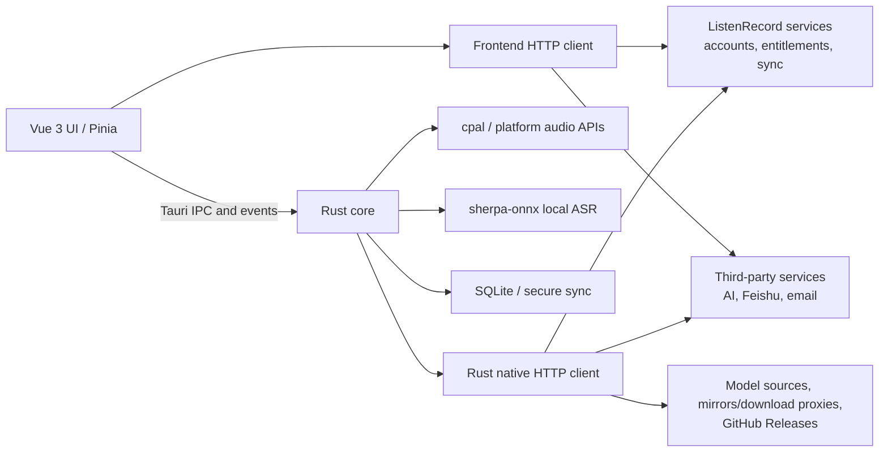
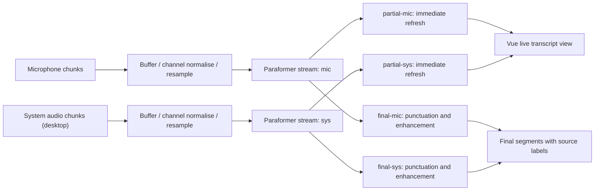

# ListenRecord engineering notes

Technical choices, architecture and implementation details. For the product overview, downloads and screenshots see [README.en.md](README.en.md).

## Why "local-first + Tauri 2"

Voice applications face three constraints at once: privacy, latency and platform capability. Running recording and ASR locally reduces the network dependency of the live transcription path, avoids latency caused by network jitter, and means a long recording does not have to be uploaded before you see any result. The product still needs model distribution, online AI, accounts and entitlements, sync and external integrations, so "local-first" is the accurate description — not "fully offline".

Tauri 2 offers a practical engineering compromise: Vue handles fast iteration on the interface, while Rust handles native capabilities such as audio devices, system permissions, the inference engine, files and the database. Compared with putting all logic in the WebView, this boundary makes real-time tasks and platform APIs easier to control; compared with maintaining a full native UI per platform, it reuses most of the product-layer code. The cost is that WebView behaviour, permission models, audio stacks and packaging toolchains still differ per platform — cross-platform does not mean all five platforms behave identically.

## Architecture

The network egress paths in this diagram are parallel, not sequential: accounts, entitlements and sync may be reached by the frontend API client, while external integrations such as Feishu may also be called directly from the frontend; Rust takes on some proxying and model downloading. Requests may be issued by either the frontend or Rust, so not all traffic passes through Rust or through ListenRecord's own services. The actual data egress depends on the features you enable, the services you choose and the configuration of that particular version.

## Engineering notes

### 1. The Tauri boundary: leave the WebView to the UI, hand deterministic work to Rust

**Problem:** recording, resampling, live recognition, file writes and platform permissions can be long-running or timing-sensitive. If that work occupies the UI main thread, the longer the recording runs the more likely you are to see jank, event pile-up and state drift.

**Approach:** Vue/Pinia manages view state and user flow, issues commands over Tauri IPC and receives progress, audio levels and recognition results via events; Rust manages audio devices, worker threads, inference sessions, files and the database. Long-running work runs on threads or async tasks, and IPC carries only the control messages and results that are actually needed, so the WebView render loop is never blocked.

**Trade-off:** a clear boundary makes native capability more controllable and frontend iteration faster, but state that crosses the boundary must be designed explicitly. Command cancellation, window close, device switching and error recovery cannot rely on a single frontend variable — Rust and the UI need a shared understanding of the task lifecycle.

### 2. Streaming ASR: turning continuous audio into correctable incremental text

**Problem:** audio devices deliver inconsistent sample rates, channel counts and chunk sizes, while a streaming recogniser needs stable input. Users also want text immediately, but a segment that has not seen an endpoint decision may be revised by later speech; in meeting mode, microphone and system audio must additionally keep their source labels.

**Approach:** the capture layer buffers audio chunks, normalises channels and resamples for ASR, then feeds them to the sherpa-onnx streaming Paraformer for incremental decoding. In-progress candidates refresh through `partial` events, and text confirmed at an endpoint goes through punctuation and text enhancement before being committed through `final` events. Meeting mode builds separate streams for the microphone and system audio, and both events and final segments carry a `mic` / `sys` source label.

**Trade-off:** `partial` gives low perceived latency but cannot be treated as a stable record; `final` is more reliable but must wait for an endpoint or for tail completion on stop. The two-stream design distinguishes "what we said" from "what the other side or the media played", at the cost of two sets of buffers, inference state, echo interference and result merging — which is why it is an enhancement for desktop meetings rather than a uniform baseline across platforms.

### 3. Cross-platform system audio: one capability, three audio stacks

**Problem:** there is no unified cross-platform API for "record what the computer is playing". Device models, permissions and callback formats differ per system, and abstracting them behind a single record button hides real differences.

**Approach:** macOS uses ScreenCaptureKit and follows the system screen-recording permission flow; Windows captures the default output via WASAPI loopback; Linux works through a PulseAudio monitor source and is also compatible with the PulseAudio compatibility layer provided by PipeWire. Data captured on each platform is normalised into a processable sample format before entering the recording and ASR pipeline above.

**Trade-off:** the upper layers can reuse recording, transcription and the event protocol, but low-level behaviour still depends on the system environment. Differences in audio server, default output and monitor source configuration are especially visible on Linux. Android and iOS currently do not support system audio capture or microphone/system-audio meeting dual streams, so mobile cannot be treated as a full replica of desktop capability.

### 4. Local data and secure sync: encrypted sync is not "full-database encryption"

**Problem:** meetings and tasks first need to be stored reliably on the local machine, while cross-device sync must not mistake "it can be transmitted" for "the security model is complete". Changing the sync password should not require re-encrypting all historical records either.

**Approach:** the current primary data store is SQLite; Dexie/IndexedDB only handles migration of data from older versions and is not the current primary store. Secure sync for meeting and task records uses envelope encryption: a KEK is derived from the sync password with Argon2id, a DEK is generated at random, and records are encrypted with ChaCha20-Poly1305; the v2 format binds record type, local identity, generation, deletion state and schema metadata into the AAD, so ciphertext is tied to its context. Changing the sync password re-derives the KEK and re-wraps the DEK, with no need to re-encrypt records individually.

**Trade-off:** this lowers the cost of password changes and can detect substituted ciphertext or key metadata, but its scope is strict: it describes **sync encryption for meeting and task records**, not full-disk encryption of the local SQLite database, and it does not mean that audio files are on the same encrypted sync path. Sync security also depends on client key lifecycle, the server protocol, authentication and recovery flows — algorithm names alone are not an absolute guarantee.

### 5. AI orchestration: local transcription as the source, online capability on demand

**Problem:** summaries, titles, action items, translation and mind maps need different prompts, output structures and context lengths; online models are in turn affected by network conditions, service availability, account entitlements and permission configuration. Treating the AI response as the single source of truth means one failure can take down the whole recording workflow.

**Approach:** local transcription is the content source for everything downstream, and users can trigger summaries, titles, action-item extraction, translation or mind maps on demand from existing text. The client handles input, structured output and error states per feature; external actions such as Feishu sync and email run independently and do not prevent local recordings and transcripts from remaining usable. Client documentation and logs must not disclose service credentials, and engineering should prefer server-side proxying or secure injection over embedding long-lived credentials in the client binary.

**Trade-off:** online models widen organizing capability and model choice while introducing network and service boundaries. When the user is signed out, out of entitlement, missing a permission, or when a request times out or a third party fails, the app should preserve the local recording and transcript and allow a retry later, rather than promising that every AI feature is always available. The data sent to each service should be judged against the specific feature and the privacy policy.

### 6. An Android pitfall: `DT_NEEDED` is not "linked means present"

**Problem:** under `--as-needed` linking behaviour, an Android Rust `cdylib` can lose the `DT_NEEDED` entry for `libc++_shared.so`. Native libraries that depend on sherpa-onnx/ONNX Runtime then crash at runtime because symbols such as `__cxa_pure_virtual` cannot be resolved; adding ordinary link flags on the Rust side does not necessarily preserve the dependency.

**Approach:** after the build, `patchelf` injects the `libc++_shared.so` dependency into each ABI's `libapp_lib.so` that actually ends up in the APK; `libc++_shared.so`, sherpa-onnx and ONNX Runtime libraries are then added for the actual ABI, and the APK is replaced and repackaged. The pipeline continues to check the ABI, the required runtime libraries and the `DT_NEEDED` entries inside the APK before aligning and signing it. The current public target is `arm64-v8a`; the release pipeline rejects unexpected non-ARM ABIs and verifies the target runtime libraries actually packed into the artifact.

**Trade-off:** post-processing reliably fixes a problem at the artifact level, but it also means the build is no longer a plain `tauri android build`. `patchelf`, zip alignment, ABI verification and signing order all become part of the release chain. CI performs the signing flow; which signature a local script uses depends on the local configuration and must not be assumed to be a production signature — the final certificate and APK contents still need verification before release.

### 7. Release engineering: artifacts are a product interface too

**Problem:** a cross-platform build is not done when it "compiles successfully" — users must receive the right format for their platform, and older clients must be able to verify and discover desktop updates. Mobile packages and the desktop updater must not be conflated either.

**Approach:** the release pipeline produces a Windows x64 NSIS installer, a macOS aarch64 DMG, Linux amd64 AppImage/DEB and an ARM64 Android APK. GitHub Releases distributes release notes and attachments in one place; the public `latest.json` covers macOS Apple Silicon, Windows x64 (NSIS), Linux x86_64 and Android — five entries across four platform families — and drives in-app desktop updates. Installers and update payloads come from the same official mirror source, so there are no two artifacts with different contents depending on the distribution channel.

**Trade-off:** a single Release page lowers distribution cost, but each platform still has its own signing, permission and system-security prompts. The Linux in-app update payload is the very same single-file AppImage as the download offered on the website, so no extra package format is needed; mobile platforms such as Android do not use the desktop updater. Release checks need to cover "installs, launches, correct ABI/architecture, matching update metadata" rather than just a successful build command.

### 8. Handing meeting summaries to a terminal agent

**Problem:** once summaries and action items exist, users often want to move them into an editor, a terminal or another AI tool. Handing over the entire meeting dataset — including the full transcript and audio files — to an external agent exposes more sensitive content than necessary; letting an agent read the local database directly would turn the client's storage layout into a public interface, so any later storage change becomes a breaking change.

**Approach:** users can explicitly enable "Agent Access" in settings and generate a long-lived access token, after which terminal agents such as Codex and Claude Code can read meeting summaries and tasks read-only over the standard MCP protocol. What is uploaded is a trimmed snapshot containing only structured results such as summaries, titles and tasks, and whether the full transcript is included is the user's choice. This path is independent of end-to-end encrypted sync for meeting and task records: agent-readable data does not enter the encrypted sync path, and when the user turns the switch off the server clears the uploaded snapshot immediately.

**Trade-off:** this closes the loop of "record → summarize → hand to an agent", and keeps the client's storage layout out of the interface. The cost is that the user must authorize explicitly and understand that this is a different path from end-to-end encryption — its visibility is decided server-side, so it is off by default, enabled on demand and revocable at any time.

## Design trade-offs and limitations

- **Initial model download:** ASR inference runs locally once models are downloaded, but fetching models for the first time, updating them, or re-fetching after cleaning still requires network access and sufficient disk space.
- **WebView and platform differences:** Tauri reuses the UI layer; it does not remove behavioural differences between WebViews, permissions, windows and file dialogs across systems.
- **Linux audio environment:** system audio depends on a PulseAudio monitor source, or the PulseAudio compatibility layer provided by PipeWire; distribution, audio server and device routing differences can affect availability.
- **Mobile audio:** Android and iOS currently do not support desktop system-audio capture or meeting dual streams, and mobile does not use the desktop updater.
- **iOS distribution:** the project has a foundation for local iOS builds, but there is currently no public CI installer, and this repository does not offer an iOS download.
- **Public architectures:** desktop installers currently cover macOS Apple Silicon, Windows x64 and Linux x86_64/amd64, and Android is provided for `arm64-v8a`; Windows ARM, Linux ARM and 32-bit Android public installers are not provided.
- **Online features:** model downloads, online AI, accounts/entitlements, sync, Feishu, email and updates reach the network as needed, and may be affected by region, network, permissions or third-party service status.
- **Repository nature:** this is a binary distribution repository for a closed-source application, not a source mirror; a public Release does not mean the application is licensed under an open-source licence.

---

[← Back to README](README.en.md)
